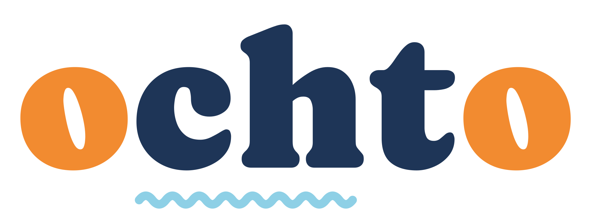

  

<strong>All your Claude Code accounts, side by side.</strong>

Ochto is a Mac app that runs two or three Claude Code accounts at the same time, in one window: live session states, the next session waiting for you, and 5-hour and weekly limits per account.

- **Website:** https://pportella23.github.io/ochto-releases/
- **Download (7-day free trial):** [Ochto-arm64.dmg](https://github.com/pportella23/ochto-releases/releases/latest/download/Ochto-arm64.dmg) · Apple silicon, macOS 13+, requires [Claude Code](https://code.claude.com/docs/en/setup)
- **Buy:** US$ 39 one-time ([pricing](https://pportella23.github.io/ochto-releases/#pricing)) · no Brasil, R$ 149 com Pix ([preço](https://pportella23.github.io/ochto-releases/pt/#preco))
- **Homebrew:** `brew install --cask pportella23/tap/ochto`
- **Support:** [open an issue](https://github.com/pportella23/ochto-releases/issues)

This repository hosts Ochto's releases and website only; the app's source code is not public. Ochto is an independent app, not made by, affiliated with or endorsed by Anthropic. [Terms and privacy](https://pportella23.github.io/ochto-releases/terms.html).
